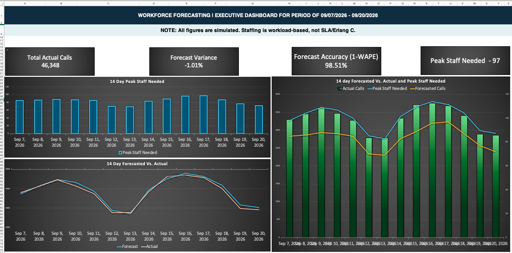

# workforce-forecasting-analysis
Excel-based workforce forecasting, staffing analysis, and executive dashboard using simulated contact center data.
# Workforce Forecasting & Capacity Planning | Excel Analytics Portfolio

### Executive Dashboard • Forecast Accuracy • Staffing Requirements • Operational Analysis

## Project Overview

This project demonstrates workforce forecasting, capacity planning, and operational performance analysis using Microsoft Excel.

The model simulates a contact center operation over a 14-day reporting period, using forecasted and actual call volumes to evaluate forecasting accuracy and estimate staffing requirements.

An interactive Excel workbook brings together the underlying data, forecasting calculations, staffing assumptions, and an executive dashboard designed to communicate operational performance.

**Reporting Period:** September 7–20, 2026  
**Data Source:** 100% synthetic/simulated data  
**Primary Tool:** Microsoft Excel

## Executive Dashboard

The dashboard provides a consolidated view of call volume, forecasting performance, and workforce staffing requirements.

### Key Performance Indicators

| Metric | Result |
|---|---:|
| Total Actual Calls | 46,348 |
| Forecast Variance | -1.01% |
| Forecast Accuracy (1 − WAPE) | 98.51% |
| Peak Staff Needed | 97 |

*These results are based on simulated data and should not be interpreted as actual contact center operating results.*

## Business Problem

Accurate call volume forecasting is essential to effective workforce planning.

Underforecasting can result in insufficient staffing, increased occupancy, and additional pressure on employees. Overforecasting may lead to unnecessary labor costs and inefficient resource allocation.

This project explores three operational questions:

1. How closely do forecasted call volumes align with actual demand?
2. How does changing call volume affect estimated staffing requirements?
3. How can forecasting and staffing information be presented clearly for operational leadership?

## Model Assumptions

The staffing model uses the following assumptions:

| Assumption | Value |
|---|---:|
| Average Handle Time (AHT) | 360 seconds |
| Target Occupancy | 85% |
| Shrinkage | 30% |
| Forecast Interval | 30 minutes |
| Operating Hours | 10 hours per day |
| Days Modeled | 14 |
| Data Classification | 100% Synthetic |

These assumptions provide a consistent basis for evaluating workload and staffing requirements.

**Important:** Staffing calculations are workload-based, incorporating handle time, occupancy, and shrinkage. The model does not use Erlang C or calculate service-level attainment, abandonment rates, or probability of delay.

## Methodology

### 1. Call Volume Forecasting

Forecasted call volumes are compared against simulated actual volumes over the reporting period.

The analysis includes daily demand trends, differences between forecast and actual volume, and an overall forecast variance measurement.

### 2. Forecast Accuracy

Forecast accuracy is evaluated using the complement of Weighted Absolute Percentage Error (WAPE):

**WAPE = Sum of Absolute Forecast Errors / Sum of Actual Calls**

**Forecast Accuracy = 1 − WAPE**

This approach measures the magnitude of forecasting errors without allowing positive and negative errors to cancel one another out.

Forecast variance is reported separately to indicate the overall direction and size of the difference between actual and forecasted demand.

### 3. Workforce Staffing Estimates

Staffing requirements are estimated using projected workload, average handle time, target occupancy, and shrinkage.

These estimates represent workload-based staffing requirements under the model assumptions, rather than staffing levels guaranteed to meet a particular service-level target.

### 4. Executive Dashboard Development

The Excel dashboard combines:

- Forecasted versus actual call volume trends
- Daily peak staffing requirements
- A combined call volume and staffing visualization
- Executive-level KPI summaries
- Model assumptions and data classification disclosures

The objective is to make operational information accessible for both detailed analysis and management review.

## Key Observations

Based on the simulated dashboard results:

- **Forecast accuracy:** The model reports 98.51% accuracy using the 1 − WAPE calculation.
- **Forecast variance:** Overall volume variance is -1.01%, indicating that actual demand was slightly lower than forecasted demand under the model's variance convention.
- **Staffing demand:** The highest modeled staffing requirement is 97, illustrating the capacity needed during the highest-demand period.
- **Demand patterns:** Forecasted and actual call volumes follow similar daily trends, including periods of increased and reduced workload.

These observations illustrate how forecasting performance and workload changes can be evaluated together to support workforce planning.

## Excel Skills Demonstrated

- Forecasting and variance calculations
- Workforce capacity and workload analysis
- KPI development and reporting
- SUM, SUMPRODUCT, ABS, MAX, and other Excel functions
- Dynamic text and date formatting
- Combination charts with primary and secondary axes
- Dashboard formatting and executive reporting
- Model documentation and transparent assumptions

## Workbook Structure

| Worksheet | Purpose |
|---|---|
| Dashboard | Executive KPIs and data visualizations |
| Daily Forecast | Daily forecast and actual call volume analysis |
| 30-Min Intervals | Intraday forecasting and workload data |
| Assumptions | Operational planning inputs |

## Limitations & Future Enhancements

This project uses simulated data and simplified workload-based staffing calculations.

Potential future enhancements include incorporating Erlang C service-level modeling, evaluating intraday forecast accuracy, adding more operational performance indicators, and developing scenario-based staffing projections.

## Professional Context

This portfolio project draws on more than 11 years of professional experience in Workforce Management and Operations Analytics, including call volume forecasting, staffing analysis, reporting, and operational support.

The purpose of this project is to demonstrate practical analytical skills and the ability to translate operational data into useful information for business leaders.

**All project data is simulated and is not proprietary employer information.**

---

*Created as part of a professional analytics portfolio focused on Workforce Management, Operations Analytics, and Business Intelligence.*
